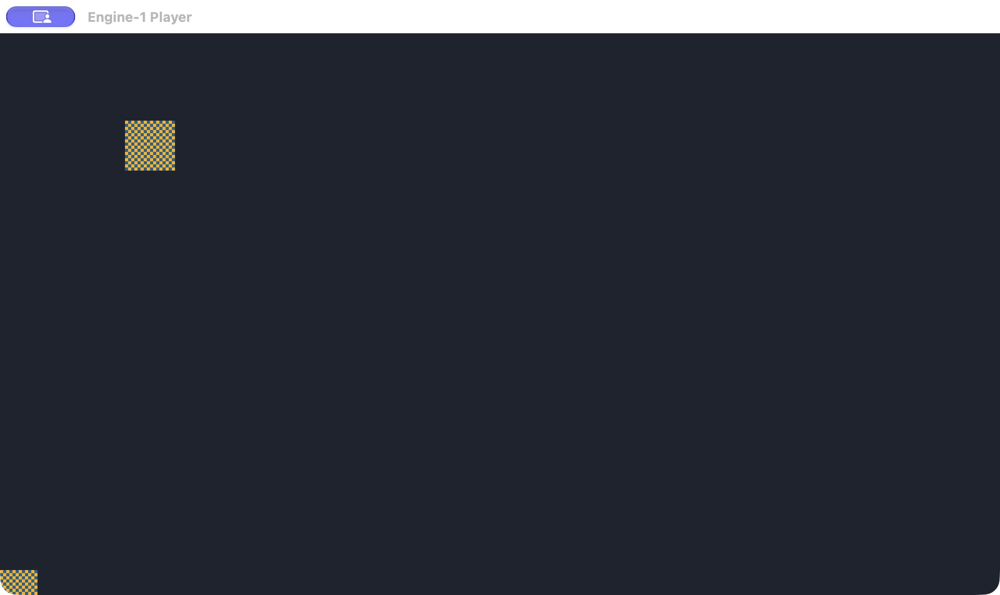

# M3 runtime와 호스트 경계

M3 시작 snapshot은 확정 문서와 PNG 디코드 결과를 소유한다. GPU 자료·편집 이력·dirty를 소유하지 않는다.
시작 시 자산을 전부 읽지 못하면 실패하며 이미 열린 문서와 저장 파일은 유지한다. 원본에 실행 상태를 반영하지 않는다.
`engine-runtime`의 CPU RGBA 합성과 정수 배율 camera를 editor와 독립 player가 공유한다.
렌더링 순서는 문서 개체 순서, 배경은 불투명, 합성은 정수 alpha 반올림이다.
M3에는 행동 코드가 없어 입력으로 개체를 이동시키지 않는다. 입력 상태와 tick을 관찰하는 기반이다.

이 브랜치의 선행 M2는 `050a8da`이다. GitHub에서 M2 PR은 병합됐으나 main은 PR12 상태이므로
M3 PR은 M2 최종 브랜치를 선행으로 두며 main을 직접 변경하지 않는다.

## 실행 제어와 입력

Play는 확정된 문서만 복사하므로 입력 draft가 있으면 먼저 확정해야 한다. 실행 중 편집·저장·프로젝트 전환은 거부한다.
Stop은 원본·dirty·undo/redo를 바꾸지 않는다. 종료의 저장 확인에서는 Stop 뒤 원본을 저장한다. 취소는 실행을 보존한다.
고정 60 tick이며 실시간 한 프레임의 오래된 backlog는 최대 8 tick으로 제한한다.
Pause 뒤 1 tick 또는 도구의 N tick은 1~100000 범위에서 정확히 실행하며 따라잡기 제한을 사용하지 않는다.
키보드 WASD/방향키와 Space·왼쪽 마우스를 action으로 바꾼다. 화면 클릭으로 포커스를 얻고 TextEdit·모달·포커스 상실 때 해제한다.
실행 snapshot PNG 합산 RGBA 예산은 256 MiB이다. 최대 논리 프레임 4096²은 64 MiB이며 GPU/GUI 캐시는 별도이다.
정적 장면은 시작할 때 렌더하고 호스트가 텍스처를 보관한다. `frame`은 호스트 표시 요청 횟수이며 GPU 완료 fence가 아니다.

## 독립 player

`cargo run --locked -p engine-player -- PROJECT.json`은 editor/CLI/MCP 없이 같은 runtime과 입력·camera 호스트로 실행한다.
프로젝트와 상대 PNG를 읽으며 저장하지 않는다. `--headless-ticks N`은 같은 snapshot의 정확 tick/hash smoke이다.
headless 결과는 네이티브 창의 실제 출력 검증을 대신하지 않는다. M10 export 패키징·서명·공증은 별도 단계이다.

## 실제 화면

macOS ARM64/Retina 실제 eframe 창에서 dirty 문서 Play→Pause→73 tick→Stop→undo→재시작을 확인했다.
아래는 pause 후 tick 88/frame 39 상태이다. PNG·JSON hash는 흐름 전후 같았다.

macOS 실제 독립 player의 같은 fixture 출력:

## M4 선행 bounded 실행 실험과 지원 후보

`cargo run --locked -p engine-runtime --example behavior_probe`는 작은 텍스트 명령(`add`, `jump`, `fail`)을 파싱해
정상 계산·줄 번호가 있는 문법 오류·10000 instruction 무한 반복 중단·실행 오류를 검사한다. 2026-10-26 macOS ARM64에서 네 경우를 실행했다.
호스트 IO가 없는 명령 집합과 instruction budget은 같은 프로세스의 editor/player에 넣을 수 있는 격리 후보의 최소 실험이다.
이 toy 문법을 제품 행동 언어로 확정하지 않는다. M4에서 표현력·소스 위치·메모리 예산·호스트 API를 포함해 실제 작성 경로를 선택해야 한다.
Rhai/Wasm 등 외부 언어 backend의 통합/중단 가능성은 아직 검증하지 않았다.

지원 1차 후보는 macOS ARM64 + Windows x64, OS별 native build이다. CI 기준은 macOS 15/Windows 2025 runner이며,
사용자용 최소 OS 후보는 macOS 15/Windows 11이다. 최소 OS 실기기·Mac Intel·Windows ARM은 확정하지 않았고 M10에서 인수한다.
현재 60Hz 목표는 기본 320×180 정적 장면이다. 최대 해상도와 임의 자산 수에 대해 60Hz를 보장하지 않는다.
현재 기준선은 native tick/frame·프로세스 시작+load+step 시간·headless RSS이며, snapshot 생성과 CPU 합성만의 별도 측정은 추가 과제이다.
정적 화면은 1회 합성/업로드하여 반복 frame의 CPU 전체 재합성을 피한다.

정상 창 닫기·Cmd+Q의 dirty 취소 보존은 기존 보호 경로를 사용한다. Dock Quit와 강제 종료의 미저장 복구는 아직 지원하지 않는다.
강제 중단 뒤 복구 가능한 지점은 마지막 성공 저장이며 M3가 checkpoint나 마지막 입력 복구를 추가하지 않는다.
