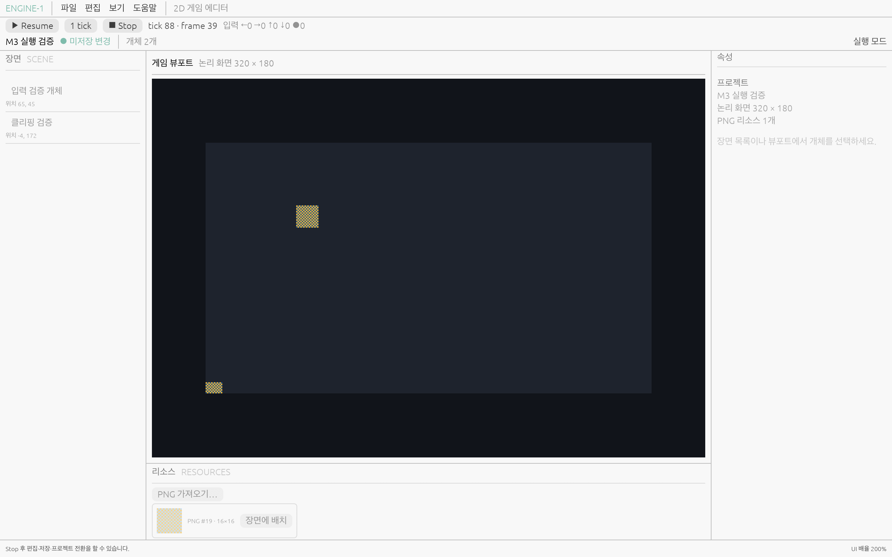

# M3 runtime와 호스트 경계

M3 시작 snapshot은 확정 문서와 PNG 디코드 결과를 소유한다. GPU 자료·편집 이력·dirty를 소유하지 않는다.
시작 시 자산을 전부 읽지 못하면 실패하며 이미 열린 문서와 저장 파일은 유지한다. 원본에 실행 상태를 반영하지 않는다.
`engine-runtime`의 CPU RGBA 합성과 정수 배율 camera를 editor와 독립 player가 공유한다.
렌더링 순서는 문서 개체 순서, 배경은 불투명, 합성은 정수 alpha 반올림이다.
M3에는 행동 코드가 없어 입력으로 개체를 이동시키지 않는다. 입력 상태와 tick을 관찰하는 기반이다.

이 브랜치의 선행 M2는 `050a8da`이다. GitHub에서 M2 PR은 병합됐으나 main은 PR12 상태이므로
M3 PR은 M2 최종 브랜치를 선행으로 두며 main을 직접 변경하지 않는다.

## 실행 제어와 입력

Play는 확정된 문서만 복사하므로 입력 draft가 있으면 먼저 확정해야 한다. 실행 중 편집·저장·프로젝트 전환은 거부한다.
Stop은 원본·dirty·undo/redo를 바꾸지 않는다. 종료의 저장 확인에서는 Stop 뒤 원본을 저장한다. 취소는 실행을 보존한다.
고정 60 tick이며 실시간 한 프레임의 오래된 backlog는 최대 8 tick으로 제한한다.
Pause 뒤 1 tick 또는 도구의 N tick은 1~100000 범위에서 정확히 실행하며 따라잡기 제한을 사용하지 않는다.
키보드 WASD/방향키와 Space·왼쪽 마우스를 action으로 바꾼다. 화면 클릭으로 포커스를 얻고 TextEdit·모달·포커스 상실 때 해제한다.
실행 snapshot PNG 합산 RGBA 예산은 256 MiB이다. 최대 논리 프레임 4096²은 64 MiB이며 GPU/GUI 캐시는 별도이다.
정적 장면은 시작할 때 렌더하고 호스트가 텍스처를 보관한다. `frame`은 호스트 표시 요청 횟수이며 GPU 완료 fence가 아니다.

## 실제 화면

macOS ARM64/Retina 실제 eframe 창에서 dirty 문서 Play→Pause→73 tick→Stop→undo→재시작을 확인했다.
아래는 pause 후 tick 88/frame 39 상태이다. PNG·JSON hash는 흐름 전후 같았다.

